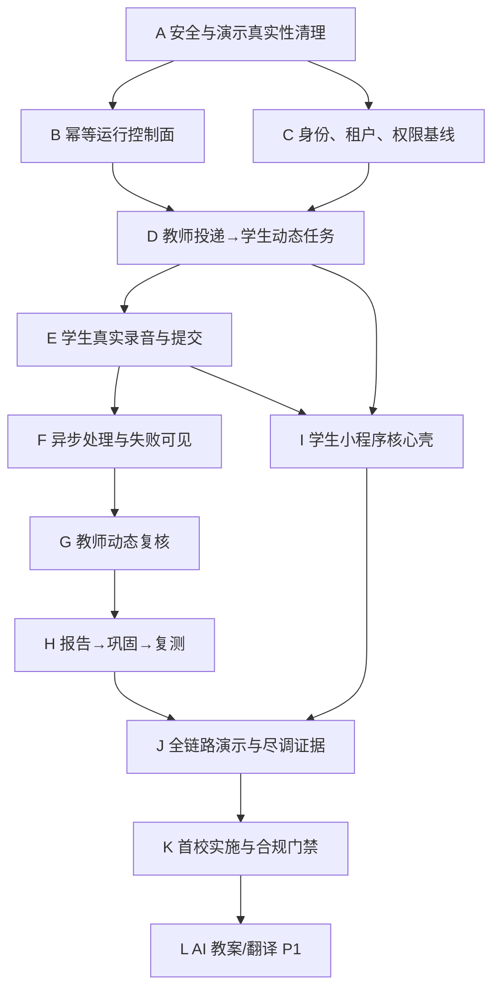

# 05｜开发路线、任务图与验收门禁

## 2026-10-18 校准 v6｜YZ-RD-T007 教师任务筛选、目标学生与动态复核入口

**BLOCKED / OFFLINE_IMPLEMENTATION_AND_TESTS_PASS；LIVE_API_DB_CHROMIUM_NOT_RUN。** 基线 `feat/question-bank-v1@ee77c899aa36effc3b661f7ce5bde48dbdb574dc`。本节记录源码与离线测试结果；实时教师 A/B、跨班学生、PostgreSQL/API 和 Chromium 证据仍需在 T007 获准的运行环境补齐。

### 实际改动

- `/teacher/assignments/` 继续作为唯一规范任务页。列表查询现在支持教师授权范围内的班级、任务状态、标题关键词、截止日期起止，并使用真实 `limit/cursor` 分页；页面只标注当前已加载范围。班级筛选也匹配指向该班学生的个人目标。
- 任务详情重新读取同一个 Assignment，复用授权班级 `student-summaries`、真实 Assignment submissions、统计和 AssessmentReview queue。班级目标与个人目标合并去重；每位目标学生展示真实最近一次 Submission 状态。提交入口使用真实 `submissionId`；关联题目复核使用真实 `itemId`。网络失败提供重试，零目标有空状态。
- 服务端按当前教师 ACTIVE 班级过滤列表中的 AssignmentTarget、详情、统计与提交；Assignment stats 按唯一活跃目标 enrollment 和每位学生最新 attempt 计数。Assignment submissions 查询也只返回目标内且当前教师有权查看的 enrollment。
- 老 `/teacher/assessments/`, `/tasks`, `/detail`, `/create` 页面入口返回 308 到 `/teacher/assignments/`；动态 `assignmentId` 保留，旧 create 入口打开规范创建表单。停用、复制、导出明确显示暂不支持。
- OpenAPI/generated types 补齐 Assignment list/detail/submissions 和 AssessmentReview queue/detail/submit 契约。Queue rows 附带可选真实 `assignmentId` / `submissionId`。未改 Prisma schema、正式成绩或评分规则。

### 离线验证与待补运行证据

- PASS：API typecheck；28 个 Assignment、Submission scope/status、AssessmentReview queue 定向单测；OpenAPI lint/typecheck 与当前规范直接生成类型比对；17 个 frontend test/runtime checks；JavaScript/Python 语法和 `git diff --check`。
- NOT_RUN：T007 隔离 PostgreSQL/API/Chromium 真实点击、Teacher A/B 与跨班/跨校学生负控、DB count 对账、失败恢复与 1280/1440 布局。执行记录注明 `BUSY_HOST` 且本会话没有 resource-admission capability，本轮没有启动或停止服务。浏览器验收脚本为 `tests/e2e/assessment/test_yz_rd_t007_assignment_flow.py`，需要 T007 自有隔离数据和 `YZ_T007_*` 环境变量。
- 下一步：在获准的独立运行环境执行上述 E2E/API/DB 旅程，记录动态 ID、状态与响应式浏览器证据；通过后再将 T007 标记 DONE。T005 双语工作与资源继续受保护。

## 2026-10-18 校准 v5｜YZ-RD-T006 Web 教师工作台真实数据首包

**DONE / WEB_API_BROWSER_VERIFIED；REAL_DEVICE_AND_PILOT_NOT_RUN。** 工作范围限定 Web。起点为 `feat/question-bank-v1` / `4d9322fc9494e284eb028e032694b0572692489f`。开工时保留了 T005 藏汉双语未提交代码和原有 `习题课程资源/`；T006 没有覆盖、暂存或提交 T005 文件，也没有修改 `local_sources/`、`pnpm-workspace.yaml`、题库素材或原始课程资源。

### 接口契约与实现

- `GET /schools/:schoolId/teacher/dashboard` 仍是教师首页唯一仪表盘 API。Controller 角色门禁保留；response DTO/OpenAPI/生成类型一致描述本人姓名、学校名、当前日期、课程数、授权范围内的任务/学生/待复核记录。无授权班级时仍返回空集合与 0。
- 仪表盘课程统计现按 `course.authorUserId` 和当前教师过滤；任务、学生和 Submission 按教师 ACTIVE 班级/学生 enrollment 过滤；任务目标人数及完成数来自真实 CLASS/STUDENT AssignmentTarget 与真实 Submission，不再写死 `done=0,total=0`；删除假学生“学习进度滞后”、虚构趋势和学校级报告数量。
- 学生学习情况复用 `GET /schools/:schoolId/classes` + `GET /classes/:classId/student-summaries`：姓名、已记录活动完成度、提交/缺交数量、最近活动来自实际学生摘要。首页选择的 classId 必须来自同一响应的本人授权班级集合；学生点击进入正确班级详情并定位本人行。
- 补齐现有 `GET /schools/:schoolId/assignments/:assignmentId/stats` 的 OpenAPI/TypeScript 响应合同。任务页按真实 target、Submission 显示提交/目标数量；注意事项读取任务统计和 dashboard review 项，待复核项跳到真实 `/teacher/submissions/:submissionId`。
- 既有 class summary 路由现在检查目标 Class 的实际教师 enrollment；教师无法用同校其他班级 ID 读取 dashboard、学生、Assignment、Assessment 或 pending stats。Submission detail 现在验证学生本人或教师任课班级，只返回当前角色有权限的数据，并在教师视图提供真实任务标题和学生姓名。
- 共享教师导航使用当前登录用户和 active-school membership，不显示固定教师名、学校名、学年、通知数或“已同步 X 分钟”。“学生”进入真实班级页面；学校切换为有效路由。
- 原旧入口 `/teacher.html`、`/teacher/review`、`/teacher/reviews/submission-1`、`/teacher/classes/detail`、`/teacher/students/*` 改为 308 到规范入口；规范 `/teacher/classes/:classId` 与 `/teacher/submissions/:submissionId` 返回各自动态详情页和静态资源。

### 正式 Web 页面与操作真值矩阵

操作状态使用：`LIVE_AND_VERIFIED` = 本任务真实 API/浏览器验证；`SOURCE_PRESENT_NOT_TESTED` = 有 API/处理代码但本任务未端到端验证；`STATIC_DATA` = 内容仍为静态样例；`DEAD_ROUTE` = 指向无效/演示记录；`UNSUPPORTED` = 明示暂不支持；`DECORATIVE` = 仅视觉/本地状态，不产生业务记录。页面状态为 `CANONICAL_LIVE`、`LEGACY_REDIRECT`、`DESIGN_REFERENCE_ONLY`、`BROKEN`。

| 页面 / 角色 | 页面功能、API 请求/返回与数据来源 | 可点击操作及真值 | 分类 / 后续验收 |
| --- | --- | --- | --- |
| `/teacher/` · 教师/学校管理员 | `GET teacher/dashboard` 返回本人 greeting、schoolName、workflow、课程、任务统计和 Submission review 项；`GET classes?limit=100` 返回授权班级；按所选 classId 取 student summaries。 | 刷新、任务（带真实 assignmentId）、复核（真实 submissionId）、班级、学生定位、空状态、网络重试及 403 切校均 `LIVE_AND_VERIFIED`。 | `CANONICAL_LIVE`；本任务 1440px/390px Chromium 验收。 |
| `/teacher/assignments/` · 教师/学校管理员 | `GET classes/teachers/me`、`GET course-versions`、`GET assignments`、每个 Assignment 的 `GET stats`、dashboard reviews；POST 新建草稿、schedule、open 延续现有 API。 | 首页任务直达行并展开 `LIVE_AND_VERIFIED`；提交率为真实 stats。班级/状态筛选有代码（`SOURCE_PRESENT_NOT_TESTED`）；时间范围、分页、••• 菜单为 `UNSUPPORTED`，未显示固定未提交/同步/复核数量。 | `CANONICAL_LIVE`；下一步做真实时间筛选、游标分页与操作菜单合同。 |
| `/teacher/classes/` · 教师/学校管理员 | `GET classes/teachers/me` 返回真实班级 id/name/grade/studentCount。 | 列表/地图、年级筛选有代码；首页到授权班级详情 `LIVE_AND_VERIFIED`。创建班级/导入学生 `UNSUPPORTED`。日历/日程/待办统计没有可用业务数据，页面明确显示暂未接入提示，不再展示演示日期和数量。 | `CANONICAL_LIVE`；日历与日程接入真实来源后再开放。 |
| `/teacher/classes/:classId` · 教师/学校管理员 | dashboard、pending-stats、student-summaries、assignment-summaries、assessment-summaries 全按本人任课班级授权；进度/最近活动/提交和复核数来自 API。静态成绩分布因无对应聚合 API 而隐藏。 | 首页学生行通过 studentId 定位真实名单记录 `LIVE_AND_VERIFIED`；当前课程和阶段摘要由 API 填充。补充练习、阶段测评/学习计划按钮有 API 代码（`SOURCE_PRESENT_NOT_TESTED`），教师写权限仍需单独端到端验证；导出/报告按钮 `UNSUPPORTED`。 | `CANONICAL_LIVE`；真值 API 与同校跨班拒绝已验证。 |
| `/teacher/submissions/:submissionId` · 教师/学校管理员/目标学生 | `GET submissions/:id` 返回 submission 状态及权限范围内的 studentName/assignmentTitle；教师只可读取本人任课班级。 | 从首页复核记录导航及真实任务/学生上下文 `LIVE_AND_VERIFIED`；通过/退回按钮有真实 API（`SOURCE_PRESENT_NOT_TESTED`）。 | `CANONICAL_LIVE`；后续验收教师评分授权与正式结果回写。 |
| `/teacher/reviews/`、`/teacher/reviews/:itemId` · 教师/学校管理员 | 复用 AssessmentReview queue/detail/submit API；queue 项使用真实 itemId。 | 页面代码和路由可用（`SOURCE_PRESENT_NOT_TESTED` 于 T006）；本次 Submission review 从首页直接进入其真实详情。 | `CANONICAL_LIVE`；下一 slice 验收 Assessment review 与 Submission review 的统一导航/队列边界。 |
| `/teacher/courses/spring/studio/` · 教师 | 课程版本读写、提交审核使用现有 CourseVersion API，home 课程数来自作者本人。 | 首页课程计数 API-backed；课程编辑页面具体按钮未纳入本次浏览器旅程（`SOURCE_PRESENT_NOT_TESTED`）。 | `CANONICAL_LIVE`。 |
| `/teacher/diagnostics/` · 教师/学校管理员 | Teacher Question-Bank catalog/dashboard/student detail/remediation API；QB-013/014 有既有浏览器门禁记录。 | 基于同一水平真实正式测评的能力视图；本任务未重跑，沿用已有 QB-013/014 证据。 | `CANONICAL_LIVE`；引用已有 QB-013/014，不冒称 T006 重验。 |
| `/student/today`、`/student/courses/`、`/student/practices/:id`、统一 Runner · 学生 | Today/课程/实践目录与 Attempt/进度 API。 | T004 已验证的学生主链路；T006 未修改。统一 student nav 的“离线可用”状态当前仍是 `DECORATIVE`，没有接入真实同步心跳。 | `CANONICAL_LIVE`；离线状态真值列入后续网页切片。 |
| `/research` · 教师/教研 | 页面 `research.js` 使用内置 counts/items；部分“创建修改任务”等只修改本地演示 state。 | 教研演示数字为 `STATIC_DATA`，本地 toast/状态变化是 `DECORATIVE`，不得当作真实成功。 | `DESIGN_REFERENCE_ONLY`；不属于本次教师首页数据。后续需真实 API 或从正式导航移除。 |
| `/teacher.html`、`/teacher/review`、`/teacher/reviews/submission-1[/index.html]`、`/teacher/classes/detail[/index.html]`、`/teacher/students/**` | 旧 teacher.js、submission-1、student demo/detail 为设计/演示页面，无规范动态业务合同。 | 已有旧入口均由 server 返回 308 到规范首页/复核/班级列表；无效固定 submission-1 和 demo 学生入口不再开放。 | `LEGACY_REDIRECT`；旧模板源文件保留用于设计参考，不再作为规范页面。 |
| `/teacher/ai-tools`、`/teacher/translation`、`/teacher/assessments/*` | AI tools 部分作业生成/草稿与外部服务、Translation jobs/glossary、Assessment sessions/reports 有既有 API。 | Translation 脚本实际调用 API；AI tools 同时包含本地交互提示；本任务未对这些页面做真实浏览器验收。 | `CANONICAL_LIVE` / 混合 `SOURCE_PRESENT_NOT_TESTED`；各页面按钮真值在后续门禁逐项验收。 |

### 真实隔离环境与浏览器证据

- Compose project `yz-rd-t006-20261018`，PostgreSQL 55606、Redis 6427、MinIO 59178/59179、API 4084、Web 4284；测试账号均为虚构，另建两名同校教师、一名跨校教师和一名无班级教师。额外学校、班级、学生以 `TEST_FIXTURE_ONLY` 命名；由真实登录、Teacher Dashboard、Classes、Assignment Stats、Student Summary、Submission APIs 读取。没有用静态 Response 代替服务端数据。
- 基准教师身份 `teacher.test`，测试学校/班级/Assignment/Submission 为数据库隔离 seed 的 TEST_FIXTURE_ONLY 记录：学校 `11111111-1111-4111-8111-111111111111`，班级 `eeeeeeee-eeee-4eee-8eee-eeeeeeeeeeee`，Assignment `f8888888-8888-4888-8888-888888888888`，NEEDS_REVIEW Submission `fa222222-2222-4222-8222-222222222222`。Assignment Stats API 实际返回 target 1、submitted 1、needsReview 1。
- Chromium E2E：2 passed / 0 skipped。验证真实 UI 登录、动态身份/学校/课程任务数量/学生记录、任务点击定位、Submission 复核入口、规范班级列表无演示人数/日期、班级详情和学生行定位、刷新恢复；同校另一教师、跨校教师、空班级教师返回各自记录；非教师 dashboard 403、跨学校 403、跨教师班级摘要 404。旧路线返回 308。
- 恢复/窄视口：注入一次浏览器网络失败显示明确重试；重试后真实 API 恢复。实际 390px 和 1440px 均通过无横向溢出断言。
- 截图：`/tmp/yz-rd-t006-runtime/teacher-home-1440.png`、`teacher-home-390.png`。运行结束只停止本任务 API/Web 与 Compose 项目，不停止其他开发线服务；测试数据卷保留。

### TESTS_PASS_FAIL_NOT_RUN

PASS：TeacherService dashboard 3、ClassesService teacher class scope 6、SubmissionsService 12（21 API 单测）；教师首页 view-model 3；OpenAPI lint、contracts typecheck、OpenAPI/生成类型 Prettier 检查、直接 OpenAPI type generator 与已提交生成文件逐字节一致；API typecheck/build；JS/Python syntax；独立 PostgreSQL/Redis/MinIO + real API/Chromium E2E 2 passed。浏览器验证包括真实登录、动态 API、任务与复核入口、空数据、403、跨学校/跨班、网络恢复、刷新及 390/1440 布局。

FAIL：`node --test scripts/generate-types.test.mjs` 中 4 项失败、2 项通过。失败项调用 `pnpm exec`，pnpm 自动进入 install 检查后被 `ERR_PNPM_IGNORED_BUILDS` 拒绝；测试未能完成其生成/格式集成流程。`pnpm-workspace.yaml` 的测试副作用已恢复为任务基线内容。一次扩展版浏览器运行也先抓到班级列表未加载（HTML 漏载 ApiClient）；补齐 script、移除静态卡片后全量 E2E 2 项重跑通过。绕过 package manager 的直接生成、生成文件比对、Prettier、OpenAPI lint 和 contracts typecheck 均通过。

NOT_RUN：全 monorepo 测试套件、所有次级网页的逐按钮 E2E、真实设备/现场试点、生产环境/生产账号。截图是隔离虚构账号的 Chromium 证据，不代表真实学校数据上线或教师试点批准。

### NEXT_TWO_WEB_FUNCTIONAL_SLICES

1. **P0｜Assignment 管理闭环**：为任务状态/时间筛选、分页、更多操作建立真实 query/route；按 CLASS 与 STUDENT target 去重核实 total/submitted/not-submitted；新增任务只显示后端已支持动作，对真实角色完成 create→schedule→open→学生可见的浏览器链路。
2. **P1｜教师复核中心闭环**：明确 AssessmentReview item 与 Submission review 的队列范围；从真实待复核 Submission 进入录音/答案详情，验证班级授权、通过/退回/评分 API 回写、刷新后状态一致，并移除所有演示复核入口和本地假成功。

## 2026-10-18 校准 v4｜YZ-RD-T004 学生移动 H5 学习与录音恢复

**DONE / H5_MOBILE_BROWSER_VERIFIED；REAL_DEVICE_NOT_RUN。** 起点 `feat/question-bank-v1` / `7f8ea126b4da4f26a0ab8f59d20207c8808c5292`，开工 tracked tree clean，仅受保护的 `习题课程资源/` 未跟踪。提交前 fetch 确认与远端 0/0；最终 SHA 以 Git/回执为准。此结论仅为浏览器功能门禁，不是 Android/iOS 或正式移动上线门禁。

### 实际发现与修复

- 课程准备页启动实际落到旧 written/reading 路径：实践 Attempt 现在进入已有统一 Runner，保留真实设备检查/服务端 start；未新建 Runner、Recording、SpeechJob、课程或题库系统。
- Runner 缺少课程返回入口、提交后的 processing 跳转会覆盖 API 的课程回写返回：复用已有动态课程上下文并保留 courseSync.navigateTo。assignmentId/submissionId/activityId/practiceDefinitionId 从课程与服务器传入，attemptId 来自创建/恢复 API，所有保存状态仍读取服务端。
- 截图发现跟读 AUDIO 题隐藏了已有 promptText：显示服务端安全下发的朗读文本，保持原有刺激/作答合同。
- 课程初始化重复加载 PDF，实际出现两份 iframe：视频/PDF 用请求序号拒绝过时回调；没有视频的活动隐藏空视频框。没有重做布局；390/430/1440 页面实测无横向溢出，按钮点击、滚动、返回和正文可用。
- 录音授权、生成 Blob、上传期间有状态及重复点击保护；停止/离页释放 tracks，倒计时也清理。MIME 取 MediaRecorder 实际输出/音频 chunk，候选含 WebM、MP4、Ogg，不把未知格式标成 WebM。
- 新增按服务端 enrollmentId + attemptId 分隔的 IndexedDB 本机草稿（每个 Attempt 一份待上传录音）。草稿不是业务完成事实；明确显示未获服务器保存确认。停止后缓存实际 Blob、题目、时长与幂等键，失败/刷新后可重试；上传绑定后清理。存储不可用时如实提示离页可能丢失；该不可用分支未做浏览器故障注入。
- 每次重试用相同幂等键重新获取签名 URL；已完成的 Recording 不重新 PUT，只完成/绑定重试；重新读取 AssessmentItem 确认后才显示成功。通用 recorder 去掉拒绝麦克风时的演示静音 WAV 和联网定时“已同步”，历史本机 metadata 也不视为服务器同步。

### 独立环境与证据边界

Compose project `yz-rd-t004-20261018`；DB `yz_t004`/55564、Redis6399、MinIO59066–59067（bucket `yz-t004`）、API4064、frontend4264。启动前目标端口为空；32 migrations + 原有 P0_BOOTSTRAP_ONLY seed，所有测试身份虚构。没有调用生产语音服务，没有启动 worker/scorer，没有改变评分规则或写正式报告。

T004 教师发布通过真实教师登录所得身份调用公共课程创建/编辑/publish、Assignment DRAFT1→SCHEDULED2→OPEN3 API；学生每例重新通过登录 UI 登录。T004 没有重复教师发布 UI 测试，T003 的 UI 证据属于前一里程碑。MP4 为 ffmpeg 生成的 2 秒测试画面，PDF 为测试自有排版，通过真实 Resource presign PUT/confirm API 存入 MinIO，再由课程引用。隔离 DB 夹具仅用于虚构身份/班级、现有已发布练习的班级 PracticeDelivery、CourseActivityPractice 关联和测试自有素材的版权 APPROVED；没有 SQL 创建/开放 Assignment、创建 Attempt、伪造上传/绑定/学习进度。

全部录音标记 **SIMULATED_MIC**：Chromium 的 fake device 提供音源，原生 getUserMedia/MediaRecorder 实际编码，实际播放器试听和真实上传。430px 通过约束 MIME 能力偏好走 MP4 分支，编码仍为 Chromium 原生 MP4/Opus；这不是 Safari/AAC 或真机证据。已有 worker prepareSpeechAudio 对三份实际下载对象均成功归一为 16kHz/mono/PCM16 WAV；只执行音频准备函数，没有处理 SpeechJob 或产生评分。

### 最终运行证据（4 passed / 0 skipped，53.42s）

| 视口 | Assignment | Submission | Attempt | Recording / AssessmentItem |
| --- | --- | --- | --- | --- |
| 390×844 | `de63e1d3-cb4e-4451-8620-26a4ffddecb9` | `e0d5a33a-2094-48cf-a96e-7685a3b0b095` | `9f3cfadc-982e-4aee-9d72-b0e4ef87b814` | `6bb4921b-814a-4738-94a3-f98484252b49` / `7eede783-7c99-433e-9af5-e506e0005d21` |
| 430×932 | `525334c6-9b1e-414e-ab24-bf05654a9c69` | `c33c6a1e-d839-4b3c-b7ca-31ae88d6fce6` | `95139a9b-bf6a-41a8-8e18-8c5d002539d0` | `c1fa1c0b-ebf1-4fdb-9962-7b1e9567d329` / `16705c17-671a-4e3d-a891-8a4c74e1ab55` |
| 1440×1000 | `629d90bd-db18-41e2-938f-1a92ebe149ad` | `b1641ea1-c5ee-4cce-b9b9-e75b4c5cc7a6` | `d41eaea9-3826-4700-8bc0-697ece61b781` | `f805b909-ef30-4f30-a530-5bb7bda7002e` / `394a04af-f916-4927-a373-0d1ab32ab562` |

上述每条 Recording 在 API/DB 均为 PROCESSING，已绑定本题，各有 1 个真实 SpeechJob（无 worker，不能报告语音评分通过）。对象键均为 `recordings/{recordingId}/full`；MinIO evidence download 的 Content-Type 与 Recording.mimeType 一致，下载 bytes 与试听 Blob 的 SHA-256 一致：

| 视口 | 数据库实际 MIME | 音频字节 | SHA-256 |
| --- | --- | --- | --- |
| 390 | `audio/webm;codecs=opus` | 40250 | `8c32bcfdfd7824eb26a783171149667fc1c013b8a7ef9fb400dbc341c06b370f` |
| 430 | `audio/mp4;codecs=opus` | 40739 | `4e7654cefe039162b9d3f695bf14663f2d2724a21b7c75ef54bfaaf4b8be649b` |
| 1440 | `audio/webm;codecs=opus` | 40250 | `94bff0d07b6919e06c053e44311e45ea90d0b54ea40649270723e8a1e44fb3cc` |

390px 还完成全部 4 题（2 条真实编码录音、选择、文字），检查并提交→课程回写→返回→刷新；最终 Attempt PROCESSING、2 项 ActivityProgress.completed=true、同一 Submission、正式报告0。430/1440 为部分完成恢复（各1条录音、Attempt IN_PROGRESS），不声称全部题目提交。三例课程返回重入只产生同一课程活动的一个 Attempt，recording 故障重试前后一条记录；重录未上传的音频不会制造业务记录。

| 异常/恢复 | 实际结果 / 证据级别 |
| --- | --- |
| 麦克风拒绝 / 不支持 MediaRecorder | 浏览器能力/NotAllowedError 注入，明确错误，无演示录音；不是系统权限面板或真机证明 |
| PUT 网络失败、离线、HTTP403 | 仅负向路由 abort/403 注入及 Chromium offline；无假成功，本机草稿刷新后上传成功、同一 Recording |
| 上传完成但 AssessmentItem 绑定断网 | 430px abort 绑定请求→刷新恢复 MP4 草稿→重试完成绑定，同一 Recording/SpeechJob，无重复 PUT 完成对象 |
| 过期签名 | 真实 MinIO SDK 签发过去2小时/有效60秒链接，PUT 实际403 AccessDenied / Request has expired；UI403另为负向注入 |
| 重复点击 | 同步连续两次停止/上传，最终服务端唯一记录与一个 SpeechJob；录音中导航禁用 |
| 返回/刷新 | 已保存录音从 API 恢复；未上传 Blob 从本机草稿恢复；重新进入课程练习保留同一 Attempt |
| 无权限 | 另一虚构学生读取 Recording、Attempt、课程被真实服务端403/404拒绝 |
| 空/错误/重试 | 无任务/无课程均用真实空 API；Today 网络 abort 后错误与重新加载恢复；不存在课程显示错误 |

### 检查结果与可复跑入口

PASS：API focused137（Recording19 + Practice/StudentCourses/Assignment），contracts6，frontend15（含3个本机录音真实性行为测试）+ runtime verify，course adapter/sync/shell8；API typecheck/build、frontend typecheck/build、JS（含课程 inline script）/Python syntax、git diff --check。最终 Chromium4 passed/0 skipped。真实音频归一3份 PASS；真实过期签名拒绝 PASS。

FAIL：最终检查0。开发中首轮暴露旧逐题路由、PDF重复；测试夹具曾因投放缺失、素材版权及字段/断言不匹配失败，修复夹具后重跑，上述最终证据不混用这些失败运行。原生格式带 codecs，而 blob URL fetch 的 Content-Type 只含基础 MIME，故对基础 MIME 和实际存储 Content-Type 分别校验。

NOT_RUN：Android Chrome、iOS Safari、系统级麦克风权限、真实手机麦克风/网络切换、Safari AAC、WebKit、正式设备/移动发布、生产语音服务、正式评分/教师复核报告、全库与六级全链路回归；存储不可用/浏览器驱逐本机草稿也未注入验证。只证明现有课程关联的4题练习，不能替代全部题库内容验证。

```bash
# 从根目录，独立环境已迁移/seed、配置 API/frontend/MinIO bucket 后
YZ_T004_BASE_URL=http://127.0.0.1:4264 \
YZ_T004_DB_CONTAINER=yz-rd-t004-20261018-postgres-1 \
YZ_T004_DB_USER=yz_t004 YZ_T004_DB_NAME=yz_t004 \
/tmp/yz-rd-t002-venv/bin/pytest -q -s tests/e2e/assessment/test_yz_rd_t004_mobile.py
corepack pnpm --filter @yuzan/api exec vitest run test/recordings/recordings.service.spec.ts test/assessment/practice.service.spec.ts test/student-courses/student-courses.service.spec.ts test/modules/assignments
corepack pnpm --filter @yuzan/frontend test
node --test frontend/student/courses/course-detail/*.test.mjs
corepack pnpm --filter @yuzan/contracts test
corepack pnpm --filter @yuzan/api typecheck
corepack pnpm --filter @yuzan/api build
corepack pnpm --filter @yuzan/frontend typecheck
corepack pnpm --filter @yuzan/frontend build
```

本机 pnpm shim 曾触发无关自动安装及 registry 重试，改用项目声明版本的 `corepack pnpm` 完成检查，没有修改 lockfile/工作区配置。原始 `习题课程资源/`、`local_sources/` 与 CURRENT_TASK 的保护文件全部未修改/暂存。日志、截图、实际下载音频、归一/过期签名/最终DB证据在 `/tmp/yz-rd-t004-runtime/`；本任务进程及专属容器在取证后停止，卷保留，其他任务服务未启停。

NEXT GATES：提供安全 HTTPS 测试入口和真实 Android Chrome/iOS Safari，验证系统权限、实际 MIME（含 Safari AAC）、试听、上传、网络切换及视频/PDF。下一功能切片先完成这项真机门禁，再依真实反馈处理学习体验；正式评分/发布仍走原有独立门禁，QB-009B 保持 PARKED。

## 2026-10-18 校准 v3｜YZ-RD-T003 教师真实发布闭环

本节取代 v2 中“缺少 schedule API”的当前缺口结论；v2 的 T002 证据仍作为历史范围保留。
起点：`feat/question-bank-v1` / `388874b8251946726aed68c438a396836946f345`；执行前 Git 基线一致，仅受保护的 `习题课程资源/` 未跟踪。提交前 fetch 后 `HEAD...origin/feat/question-bank-v1 = 0 0`。最终结果 SHA 以 Git 和任务回执为准，不向自身 handoff 回写自身 SHA。

### 用户结果与唯一接口契约

教师在 `/teacher/assignments/` 选择真实已发布课程和自己授权班级，填写标题、开始/截止时间，保存显示“已保存草稿”；展开任务“确认排期”后显示“已排期（需手动开放）”；“立即开放”服务端返回 OPEN 后才显示“已发布”。操作中按钮禁用，失败保留错误和重新加载入口；revision 过期必须重新加载，不能伪造发布成功。列表读取实际状态；全局重新加载也可恢复初始读取失败。

所有接口前缀 `/api/v1/schools/{schoolId}`，沿用现有认证守卫、学校上下文和响应信封 `{data,meta}`：

| 接口 | 请求 / 返回 | 权限和错误 |
| --- | --- | --- |
| POST `/assignments` | `{courseVersionId,title,startsAt,dueAt,targets:[{targetType:"CLASS",classId}]}` → 201 / DRAFT / revision=1 | 教师或学校管理员；课程 PUBLISHED、校内真实班级/有效学生、教师 ACTIVE 班级授权、合法起止时间；400/401/403/404 |
| POST `/assignments/{assignmentId}/schedule` | `{expectedRevision:1}` → 200 / SCHEDULED / revision=2 | 仅合法 DRAFT→SCHEDULED；重查课程与目标授权；400/401/403/404/409 |
| POST `/assignments/{assignmentId}/open` | `{expectedRevision:2}` → 200 / OPEN / revision=3 | 仅合法 SCHEDULED→OPEN；重查权限；400/401/403/404/409 |

`expectedRevision` 必填、整数、>=1；实际以最新响应 revision 为准。保留状态机，不开放 DRAFT→OPEN；旧 OpenAPI `:open` 修正为 `/open`。409 保留 `ASSIGNMENT_STATUS_INVALID` / `ASSIGNMENT_CONFLICT`。400 包含 DTO 错误及 `ASSIGNMENT_TIME_INVALID` / `ASSIGNMENT_TARGET_INVALID`。本功能不引入 422 分支。教师列表、详情、统计和写操作落实班级授权；学生 Assignment 列表/详情限定目标班级/个人，且不暴露草稿和排期。

唯一契约文件 `packages/contracts/openapi/openapi.yaml`、生成类型 `packages/contracts/src/generated.ts`；教师端沿用 `frontend/assets/api-client.js` 的通用 `YuzanApi.request` 解包响应并传送以上请求体，无另建契约。Controller/DTO/OpenAPI/前端调用由本任务同一负责人修改闭合。

实际文件：`backend/api/src/modules/assignments/{assignments.controller.ts,assignments.service.ts,infra/prisma-assignment.repository.ts,ports/assignment-repository.port.ts,dto/create-assignment.dto.ts,dto/transition-assignment.dto.ts}`；`frontend/teacher/assignments/{app.js,index.html}`；上述契约文件。复用既有 Policy、Repository、State Machine、Today 和课程进度路径；未修改 Prisma 模型。

### 通知与真实数据

创建 DRAFT 不再写“已发布”通知，SCHEDULED 也不写。只有 OPEN 的 revision 更新成功才进行 best-effort 通知；目标学生去重，`Notification.actionUrl=/student/today/?assignmentId={动态AssignmentId}` 绑定发布来源。并发/重放只有一次成功 revision，因此不重复产生有效通知。通知失败被隔离，任务仍然 OPEN；Today 直接读取真实任务与目标关系，独立于通知是否成功。这不是完整可靠消息/outbox 系统，故障通知不自动补发。

### 当前执行证据（CURRENTLY_VERIFIED）

环境专属 Compose project `yz-rd-t003-20261017`；DB55563/Redis6398/MinIO59064–59065/API4063/frontend4263，库 `yz_t003`。启动前端口为空，未使用/停止其他任务服务。新卷从空库执行 32 migrations 和已有 seed；seed 只提供虚构身份/基础数据，以下 Assignment 都从教师 UI 或 API 创建，课程版本从真实课程 API 创建、编辑、发布。没有 SQL 创建 OPEN 或改 Assignment 状态。原始素材未读写/暂存。

真实 Chromium + PostgreSQL：`tests/e2e/assessment/test_yz_rd_t003_publish.py` **3 passed / 0 skipped (13.08s)**：

1. 教师从登录页实际登录 → UI 创建草稿 → UI 排期 → UI 开放 → 目标学生从登录页重新登录 → Today 动态课程卡 → 真实课程 → 首个 TEXT 阅读活动确认 → 刷新显示“已确认阅读”，复用同一 Submission。
2. 教师网络失败不报成功、按钮禁用；合法 API 更新使旧 revision 冲突，UI 重新加载恢复并发布。任务私有数据库临时 trigger 仅针对该 Assignment 的通知 INSERT 抛错，OPEN 仍成功、Today 仍可见。trigger/function 在 finally 清理；事后残留数=0。
3. 两个并发 OPEN 请求为 200/409，Assignment revision 只从2变3，通知仅1条；未发布课程创建任务404。

主链路数据库证明：

| 对象 | 动态 ID / 事实 |
| --- | --- |
| Assignment | `27b18e8c-03f5-400e-93ba-79982c38a11f`，DRAFT1→SCHEDULED2→OPEN3 |
| CourseVersion | `02151290-ac43-41f5-9b8c-01f7c56b8efc`，真实 API 发布 |
| AssignmentTarget.classId | `54788a55-29ef-4ef0-9aeb-8e1f393e20e0`，1条 CLASS 目标 |
| 学生 Enrollment | `b6fbc618-3fb0-42d4-8015-cba672dea527`，ACTIVE STUDENT |
| Notification | 主 Assignment actionUrl 恰好1条，recipient 为该学生；DRAFT/SCHEDULED/失败开放均为0 |
| Submission | `1f0708d7-15e8-464e-b8b9-97b0b51064f1`，指向同一 Assignment/Enrollment，刷新仍为该ID |
| ActivityProgress | activity `51eb0ad2-dd61-43ba-9baf-7448ef85973e`，同一 Enrollment，completed=true |
| 通知故障任务 | `2717e25d-13a7-4857-95b2-73d1864f9f05`，OPEN4，通知0，Today可见；多一次合法草稿更新用于revision冲突 |
| 并发任务 | `c6f6f8f0-8be7-4905-8531-812ad5c87517`，OPEN3，通知1，两个请求200/409 |

真实负控：独立无cookie匿名请求401；学生发布403；无班级授权的真实校内教师详情/开放403、列表不含该任务；教师向无授权班级创建403；真实外校班级作为目标404、真实外校URL403；非目标学生 Assignment详情/课程详情404、Today无该任务；不存在任务404；缺 revision400、过期revision409；反向时间400。未发布课程404。失效个人学生目标由 focused unit 验证，不冒充浏览器结果。

可复现命令（从仓库根目录，pnpm 10.13.1；此主机用缓存版本的 `node /home/tian/.cache/node/corepack/v1/pnpm/10.13.1/bin/pnpm.cjs` 调用，避免默认 shim 意外启动安装）：

```bash
pnpm --filter @yuzan/database migrate:deploy
pnpm --filter @yuzan/database seed
pnpm --filter @yuzan/api test test/modules/assignments test/modules/submissions test/modules/learning
pnpm --filter @yuzan/api test test/assessment/student-today-decision.spec.ts test/assessment/student-dashboard.today.service.spec.ts test/student-courses
pnpm --filter @yuzan/api typecheck
pnpm --filter @yuzan/api build
pnpm contract:types
pnpm --filter @yuzan/contracts test
pnpm --filter @yuzan/frontend test
node --check frontend/teacher/assignments/app.js
python3 -m py_compile tests/e2e/assessment/test_yz_rd_t003_publish.py
YZ_T003_BASE_URL=http://127.0.0.1:4263 \
YZ_T003_DB_CONTAINER=yz-rd-t003-20261017-postgres-1 \
YZ_T003_DB_USER=yz_t003 YZ_T003_DB_NAME=yz_t003 \
/tmp/yz-rd-t002-venv/bin/pytest -x -s tests/e2e/assessment/test_yz_rd_t003_publish.py
git diff --check
```

结果：Assignment/Submission/Learning **138 passed**（其中发布相关69）；Today/StudentCourses **46 passed**；contracts **6 passed**；frontend **12 passed** + runtime verify；API typecheck/build、类型生成、JS/Python语法、diff检查 PASS。发布测试新增 `backend/api/test/modules/assignments/publishing.spec.ts`；现有 Assignment 单测只补合法课程/班级依赖和目标，不放松断言。全量套件未重跑。浏览器、API日志、截图在 `/tmp/yz-rd-t003-runtime/`（本机证据，非版本化生产资料）；数据库卷保留用于复核，任务专属服务验收后停止。

### 已解决 / 下一阶段

已解决：教师创建即止于草稿、缺schedule API、`:open`契约偏差、缺revision DTO、草稿错误通知、校内教师跨班级读写缺口、学生CLASS目标Assignment读取缺口、前端排期/开放/冲突恢复缺口。

剩余范围：没有 Worker 自动到时发布；SCHEDULED 必须手动开放，自动发布应作为独立功能。通知故障自动补发/可靠outbox不在本任务范围。列表分页与现有教师关注统计区仍未建设，本任务不扩展工作台。录音、SpeechJob、正式报告、六级题库全流程、移动真机均 **NOT_RUN**；当前隔离数据库 Recording/SpeechJob/AssessmentReport 均0，未运行语音供应商或worker。下一切片建议：390/430 H5 Today→课程→Runner→返回与真机录音验证；自动定时发布独立排期。QB-009B 保持 PARKED。

## 2026-10-17 校准 v2｜YZ-RD-T002（取代下文旧波次的派工顺序）

本节按本地源码与证据校准，不再把历史波次 0—2 当作待建设清单。
下文保留为原始规划参考；其中控制面、lease、CCR、固定角色签字等不构成普通功能开发前置条件，以根目录 `AGENTS.md` 的 functionality-first 为准。
基线：`feat/question-bank-v1`，`0a7b931a8dfd005eb7ba97aa0fe68e81169d61e8`；本轮实际 `git fetch origin` 后该分支 `HEAD...origin/feat/question-bank-v1 = 0 0`。它不是远端 main 的能力快照。

证据等级分别记录，不能相互替代：

- `SOURCE_PRESENT`：源码/DTO/OpenAPI 已在仓库；不等于运行通过。
- `HISTORICALLY_VERIFIED`：`CURRENT_HANDOFF.md` 的 QB-015F/016/017A、COMP-DEMO-01—05 运行记录；不冒充本轮重跑。
- `CURRENTLY_VERIFIED`：本轮实际命令证明的范围，具体见本节“当前执行证据”。
- `GAP`：尚缺的用户结果或验收证据；已有能力只补接缝，不重建 Question Bank、Runner、Recording、SpeechJob、复核、报告、巩固。

原始材料继续保护：`习题课程资源/`、`local_sources/` 不修改、不暂存、不推送。QB-009B 继续 `PARKED / EXTERNAL_INPUT`；ISE 诊断不能变成正式评分。本轮无 Prisma/schema、评分或供应商修改。

### 完整链路与施工落点

所有后端文件路径以下均相对 `backend/api/src/modules/`；所有接口前缀是 `/api/v1/schools/{schoolId}`。`{...}` 是服务返回的动态 ID，客户端不选学生身份。OpenAPI 权威文件为 `packages/contracts/openapi/openapi.yaml`，生成类型为 `packages/contracts/src/generated.ts`；本轮不新增平行契约。

| 环节 / 用户操作、页面 | 前端复用代码 | 后端 Controller / DTO / OpenAPI 定位 | API 请求 → 响应核心字段 |
| --- | --- | --- | --- |
| 教师布置课程，`/teacher/assignments/`；课程编辑/发布 | `frontend/teacher/assignments/app.js`、`frontend/teacher/courses/spring/studio/` | `assignments/assignments.controller.ts`；`dto/create-assignment.dto.ts`、`assignment-target.dto.ts`、`assignment.response.ts`；`curriculum/curriculum.controller.ts`、`dto/update-course-draft.dto.ts`；OpenAPI `/assignments`、`/assignments/{assignmentId}/open`、`/course-versions/{courseVersionId}/publish` | POST assignment `{courseVersionId,title,startsAt,dueAt,targets:[{targetType,enrollmentId或classId}]}` → `{id,status:DRAFT,revision}`；POST `/{id}/open {expectedRevision}` 只允许 SCHEDULED → OPEN；直接 DRAFT 调用实测 409，排期入口缺失 |
| 学生“今日学习”主推荐、课程卡、老师课程任务，`/student/today/` | `frontend/student/today/today.js`、`frontend/assets/api-client.js` | `student-dashboard/student-dashboard.controller.ts`；`student-today-decision.ts` 的 `StudentTodayDecision`（纯派生视图无写 DTO；`dto/today-tasks.response.ts` 是旧 DTO 导出）；`student-today-decision.ts`；OpenAPI `getStudentTodayDecision`、`StudentTodayDecisionResponse` | GET `/student/today` 无学生参数 → `{version:student-today-v1,primaryAction:{kind,target},waiting,legacyTasks:[{assignmentId}],summary}`；GET `/student/courses?limit=4` → `{courses:[{assignmentId,title,progressPercent}],...}` |
| 打开课程并恢复，`/student/courses/course-detail/?id={assignmentId}`；旧 `spring-2` 入口兼容 | `frontend/student/learn/spring-2/index.html`、`frontend/student/courses/course-detail/{course-api-adapter.js,course-player-state.js,index.html}` | `student-courses/student-courses.controller.ts`；`dto/student-course.dto.ts`；OpenAPI `getStudentCourseAggregate`、`/student/courses/{assignmentId}/submissions` | GET detail → `{assignment,courseVersion,units,practiceReferences,existingSubmission,courseCompletion}`；POST submissions `{}` → 实际 `{submission:{id,status,revision,...},resumed}`（adapter 解包） |
| 课程练习接入统一 Runner，`/student/practices/attempts/{attemptId}/runner/` | `course-api-adapter.js`、`frontend/assets/api-client.js` 的 course practice sync、`frontend/assessment/assets/practice.js` 与现有 Question Bank Runner | `assessment/practice.controller.ts` / `CreatePracticeAttemptDto`（同文件）；OpenAPI `/practices/{practiceDefinitionId}/attempts`、`/practices/attempts/{attemptId}` | POST `{assignmentId,submissionId,activityId}` → `{attemptId,...}`；GET attempt/items → 本人授权的会话、题目快照；完成后 POST `/student/courses/{assignmentId}/submissions/{submissionId}/activities/{activityId}/practice-attempts/{attemptId}/complete` |
| 答题、录音上传与提交 | `frontend/assessment/assets/app.js`、现有 Runner；课程 `exercise-controller.js`、`media-controller.js` | `assessment/assessment.controller.ts`；`dto/assessment-shared.dto.ts` 的 `SaveWrittenAnswerDto`、`AttachRecordingDto`；`recordings/recordings.controller.ts`、`dto/init-recording.dto.ts`、`complete-recording.dto.ts`；OpenAPI `/assessments/sessions/{sessionId}/items/{itemId}/answer`、`/recordings`、`/recordings/{recordingId}/complete` | PUT answer `{content}` → 实际保存状态；POST reading recording `{recordingId}` → 绑定结果；init/upload-url/complete → `{id,status,...}`；POST session submit → 实际会话状态；课程 PUT attempt `{kind,value,completed,expectedProgressRevision}` → 进度与 revision |
| 异步诊断与人工复核，`/teacher/reviews/`、`/teacher/reviews/detail/?itemId=...` | `frontend/teacher/reviews/{queue.js,detail.js}`、既有学生 processing 页面 | `assessment/assessment-review.controller.ts`、`dto/assessment-review.dto.ts`；`internal/internal.controller.ts`、worker 现有 speech processor；OpenAPI 查 session/item review、recording evidence；源码有泛用 `assessment-reviews` 路由，但当前 OpenAPI 缺该路径，是契约文档 `GAP` | GET queue/detail → 授权题目及原始录音授权播放入口；PUT `/assessment-reviews/{itemId}` `{score,comment}` → 人工正式分；旧 session/item review 接收 `{scoredScore,reviewerComment}`；现有 DTO 无 expectedRevision，不宣称已有乐观锁；诊断结果仅 student-safe allowlist，失败码如 `PROVIDER_TASK_UNSUPPORTED` 保留录音可复核 |
| 正式报告，`/assessment/sessions/{sessionId}/report/` | `frontend/assessment/assets/app.js`、既有 report renderer | `assessment/assessment.controller.ts` / `dto/assessment-session.response.ts`、`assessment.service.ts`；OpenAPI `/assessments/sessions/{sessionId}/report` | GET report → 实际正式成绩、`summary.diagnosis`（`qb-diagnosis-v1`）、来源版本；未完成复核不伪造报告 |
| 巩固与复测、教师指定巩固、学习进步 | `frontend/assessment/assets/app.js`、`frontend/teacher/diagnostics/app.js`、现有 Runner | `assessment/assessment.controller.ts`、`teacher-question-bank-diagnostic.controller.ts`、`question-bank-progress.controller.ts`；`dto/teacher-remediation-assignment.dto.ts`；OpenAPI `/assessments/sessions/{sourceSessionId}/remediation`、`/remediation-result`、`/retest`、`/students/me/question-bank-progress`；教师 `remediation-assignments` 当前缺 OpenAPI 路径，列契约文档 `GAP` | POST remediation `{}` → `{attemptId}`；教师 POST `.../classes/{classId}/remediation-assignments {practiceDefinitionId,enrollmentIds,focus}` → 作业会话；GET remediation result → 本轮结果；GET progress → 同级正式趋势和独立巩固历史 |

| 环节 | 持久化与状态变化（复用现有模型） | 已有证据 / 当前缺口 / 失败处理 / 下一步 / E2E 门槛 |
| --- | --- | --- |
| 教师布置 | Course/CourseVersion、Unit/Lesson/LearningActivity；Assignment/AssignmentTarget，DRAFT → SCHEDULED → OPEN，revision 乐观并发；当前普通 API 缺 schedule 入口，不能直接 DRAFT → OPEN | `SOURCE_PRESENT`；COMP-DEMO-03、QB-014/015 `HISTORICALLY_VERIFIED`（课程和题库巩固是两类对象，勿合并模型）。本轮课程内容创建/发布经真实教师 API；投递为显式已 OPEN 的独立 DB 夹具，学生读写仍走真实鉴权/API。`GAP`：实际 POST create 返回 DRAFT，POST open 返回 409 `ASSIGNMENT_STATUS_INVALID`，未找到 schedule 入口；不把夹具当教师发布成功。下一切片补教师合法排期/开放；门槛必须由教师 API 完成状态链而非 DB 改 OPEN。 |
| Today | 无新表；按本人当前校所有 ACTIVE STUDENT Enrollment 派生；priority/waiting/legacy 保持分离 | `SOURCE_PRESENT` + QB-017A `HISTORICALLY_VERIFIED`。本轮修复课程列表失败吞成空态；补齐 practice/course API 适配对本人全部有效学籍的选择，课程详情、写入与笔记按资源匹配学籍；移除目录对可选 capabilityTheme 非空的错误要求；加载、空、错误、等待复核、可执行分开。GET Today 失败不能显示可操作主 CTA；课程失败局部重试；主创建失败保留页面与可恢复提示。门槛：三来源动态 ID、刷新、返回、拒绝/恢复。 |
| 课程 | Submission create/resume；ActivityProgress/ActivityAttempt 保留 revision；刷新恢复同一 Submission | `SOURCE_PRESENT` + COMP-DEMO-03/05 `HISTORICALLY_VERIFIED`；`spring-2?assignmentId=` 源码明确 `location.replace` 到动态 detail，不能先宣告损坏。真实 404/403 用现有详情错误/重试 UI；本轮保留兼容路由。当前浏览器反证还发现练习控制器在课程初次加载后才订阅，首个 TEXT 活动没有渲染；本轮最小补齐 init 当前活动渲染，回归要求正文/确认阅读/刷新恢复，而非只看课程标题。MP4/PDF 不在本轮重导入；播放仍属历史证据。 |
| Runner | PracticeDefinition/PracticeVersion/PracticeItemRef → AssessmentSession/AssessmentItem 的不可变快照；CREATED → IN_PROGRESS | `SOURCE_PRESENT` + QB-015—017、COMP-DEMO-03/04 `HISTORICALLY_VERIFIED`；既有 adapter/sync 定向回归保持课程上下文与安全 returnTo；失败不删除 recovery context。门槛：新 attempt 显示真实题目、刷新同一 attempt、返回课程只做幂等完成写。 |
| 答题与录音 | AssessmentItem 保存答案；Recording UPLOADING → READY/FAILED；SpeechJob PENDING/PROCESSING → NEEDS_REVIEW/FAILED；提交后 session PROCESSING | `SOURCE_PRESENT` + QB-015、COMP-DEMO-04 `HISTORICALLY_VERIFIED`；现有重录和 unsupported-provider 展示要保留。未校准诊断不得生成正式 scoredScore。门槛：录音丢包/重录、权限拒绝、刷新持久化；本轮不调用第三方、未重跑录音。 |
| 教师复核 | AssessmentItem 人工正式分、reviewerUserId/reviewedAt；全部必填题完成后才 finalize | `SOURCE_PRESENT` + QB-007/010/015、COMP-DEMO-04 `HISTORICALLY_VERIFIED`。队列为 0 或历史已结束时显示真实 guard。`GAP`：首校教师真实操作耗时/反馈尚无授权试点证据；不能为演示强行改历史会话。门槛：跨班拒绝、已结束会话 409、原录音可听、正式分来源可追溯；并发覆盖语义未在本轮验证，不能把旧蓝图的 expectedRevision 当成当前能力。 |
| 报告 | COMPLETED STANDARD → AssessmentReport + 持久化 diagnosis；processing 不产生完整报告 | `SOURCE_PRESENT` + QB-010/015、COMP-DEMO-04/05 `HISTORICALLY_VERIFIED`。本轮报告优先级、诊断隔离前端回归；无当前 DB 报告闭环重跑。门槛：全部题完成、报告分与题目正式分一致、无 provider raw 泄漏。 |
| 巩固与复测 | REMEDIATION 新会话保留 sourceSessionId、focus、origin；重复 active resume；正式复测另建 session；源分不变 | `SOURCE_PRESENT` + QB-011/012/014/015、COMP-DEMO-04 `HISTORICALLY_VERIFIED`；本轮 Today 决策/创建失败恢复、跨有效班级的真实一级 Runner 进入与刷新及 adapter 回归，非评分/复核/巩固全链重验。门槛：同 questionVersionId 子集、教师/本人来源区分、跨学生拒绝、同级比较；不重建推荐引擎。 |

### 下一阶段按真实缺口排序的纵向切片

| 顺序 / 用户价值与缺口 | 复用 / 前端范围 | 后端范围与 API | 依赖 / 可并行范围 / 唯一 owner | 验收证据 |
| --- | --- | --- | --- | --- |
| 1. 教师布置并真正开放一项课程任务，学生 Today 可见：优先修复本轮实测 create=DRAFT、open=409 的发布卡点 | 复用 `frontend/teacher/assignments/app.js`、已有创建表单/列表、Today/course detail；补真实排期/开放操作、状态与 409 恢复；复核继续复用现有队列 | 复用 AssignmentsService/repository/state-machine/expectedRevision；**本切片后端契约 owner（唯一，由 Commander 指派一人）** 补合法 DRAFT→SCHEDULED 入口及 OpenAPI/生成类型，并明确立即/未来开始语义，开放仍走现有 SCHEDULED→OPEN；不改 Prisma。并列台账记录 review/remediation-assignments OpenAPI 缺口，按实际消费范围补齐 | 依赖课程 PUBLISHED、本人可教班级；状态契约先冻结，前端 UI 与后端实现可并行，测试在契约冻结后接入；共享 API/权限变更只由该后端 owner 串行；真实试点另行授权 | 虚构授权教师经真实 API/浏览器创建→排期→开放，学生 fresh context Today 三入口可见→课程完成→教师可查；全程动态 ID，不允许 SQL 改 OPEN；跨班403、过期revision409、刷新与重复点击。真实教师反馈后续另记，开发者走查不算试点 |
| 2. 移动 H5 完成一次 Today→课程→Runner→返回：缩小已知“1920×1080 已验收”和手机使用证据间的差距 | 复用本轮 Today、course detail、Runner/录音；390px/430px 的触控、滚动、键盘、错误恢复；优先修实际溢出与不可点区域 | API 保持现有 Today/course/practice/recording；本切片 **后端契约 owner（唯一）** 只核查上传及鉴权，无共享 API/Prisma 变更则不发起迁移 | 依赖浏览器麦克风授权与可用测试设备。不同页面 CSS/测试可并行，Runner protected 路径变更须先取得当前 owner 授权，不覆盖他人工作；本轮不施工该路径 | Chromium 390/430 动态 ID 全路径与 403/弱网恢复；iOS/Android 真机麦克风、MP4/PDF、录音上传证据单列；无真机就标 NOT_RUN，不能称移动端已验收 |
| 3. 每日短时学习与完成反馈：在现有 priority 上让学生知道今天已完成什么、下一步为何 | 复用 Today、estimatedMinutes、正式报告/进步和巩固结果；只展示服务能证实的时长/状态；不加假连续天数或固定“5 分钟” | 首先复用 GET Today/report/progress；仅在真实用户反馈证明缺少“当日完成”的定义后，由 **该切片后端契约 owner（唯一）** 定义日期时区/来源并扩展派生 DTO/OpenAPI，无先行 Prisma 变更 | 依赖前两项的可用入口/移动证据和获授权的需求反馈；前端可在冻结契约后并行，不同时编辑 Today。藏汉双语支架已有 BilingualContent/translation 能力，但缺教研确认内容与需求证据，排在本切片之后，不调用商业翻译来补假内容 | 今日完成必须能回查真实 session/submission 时间与状态；无记录、处理中、复核完、跨日、网络失败有区分；正式分不变；浏览器完成→返回 Today→刷新一致 |

不为以上并行新建平台。共享 API/OpenAPI/Prisma 每个切片由唯一后端 owner 修改；前端实现只消费冻结契约。

### 当前执行证据（YZ-RD-T002）

已定位的非 Today 阻断：隔离运行实际教师 create→open 探测返回 409 `ASSIGNMENT_STATUS_INVALID`，请求 ID `56dbac57-1c65-4074-8a12-ee56b8dcb48d`。状态机测试明确禁止 DRAFT→OPEN；本轮允许范围不包含 Assignment 状态契约扩展，保留并列为下一施工切片。

本轮测试只改 API 适配的资源→本人有效学籍映射，没有新增 DTO、端点、Prisma 或权限角色；共享 API 适配 owner 为本任务实施者一人，无并行共享面修改。最终命令与证据记录如下。

验证时间：2026-10-17；独立 Compose project `yz-rd-t002-20261017`，PostgreSQL `yz_t002` / `55562`，Redis `6397`，MinIO `59062/59063`，API `4062`，frontend `4262`；Node `v24.20.0`、pnpm `11.25.0`、Chrome headless + Playwright `1.64.0`、Python 3.10。启动前检查 `ss -ltnp`、`docker ps`，没有使用/停止其他任务的服务。只有本任务 API 为验证新构建而重启。独立测试生命周期结束后停止本任务进程/容器，保留 task 专有数据卷，不做 host prune 或共享卷删除。

| 功能 | SOURCE_PRESENT | HISTORICALLY_VERIFIED | CURRENTLY_VERIFIED | GAP / NOT_RUN |
| --- | --- | --- | --- | --- |
| 教师布置 | Controller/DTO/状态机在 | COMP-DEMO-03 导入投递；QB-014 题库指定巩固 | 教师真实 API 创建/编辑/发布课程内容 | 普通 Assignment create→open 实测 FAIL409；学生入口的 OPEN 投递是明确的 DB 夹具，不是教师发布验收 |
| 今日学习 | 原 priority 决策在 | QB-017A/F | 两种学籍场景各三入口、错误与重试、真实一级主 CTA | 首校真人使用 NOT_RUN |
| 课程/活动 | adapter/player/controller 在 | COMP-DEMO-03/05 | 首个 TEXT 正文/阅读确认，三入口同 Submission，空主题课程不再丢失；第一和第二学籍均通过 | 本轮 MP4/PDF 播放 NOT_RUN，保留历史证据 |
| Runner | 原 Runner 在 | QB-015—017 | 真实一级 20 题会话，首题可见、刷新、返回；课程上下文回写离线回归 | 本轮完整作答/提交 NOT_RUN |
| 答题/录音 | 原 answer/recording/speech-job 在 | QB-015、COMP-DEMO-04 | 课程 TEXT 写入/恢复；录音与正式分边界前端回归 | 麦克风/上传/worker/第三方全部 NOT_RUN |
| 教师复核 | 通用复核在 | QB-007/010/015、COMP-DEMO-04 | 展示/评分隔离前端回归；不是复核 DB 闭环 | 当前实时复核 NOT_RUN；通用 review OpenAPI 缺失；DTO 无旧蓝图 expectedRevision |
| 正式报告 | report/diagnosis 在 | QB-010/015、COMP-DEMO-04/05 | 正式报告优先于诊断的前端回归 | 本轮报告生成 DB 闭环 NOT_RUN；独立库无报告/录音/SpeechJob |
| 巩固/复测 | 原 remediation/progress 在 | QB-011/012/014/015、COMP-DEMO-04 | Today 创建失败可重试与原 API adapter 回写回归 | 当前巩固完成/复测 NOT_RUN；教师 remediation-assignments OpenAPI 缺失 |

实际命令与最终结果（所有 pnpm 从仓库根目录执行；设置前缀是复用已安装依赖，避免 pnpm 11 的默认自动 install，本轮未改 lockfile/workspace 配置）：

```bash
PNPM_CONFIG_VERIFY_DEPS_BEFORE_RUN=false pnpm --filter @yuzan/api exec vitest run test/assessment/practice.service.spec.ts test/student-courses/student-courses.service.spec.ts test/assessment/student-today-decision.spec.ts test/assessment/student-dashboard.today.service.spec.ts test/assessment/question-bank.security.spec.ts
# PASS: 5 files, 68 tests, 0 skipped
PNPM_CONFIG_VERIFY_DEPS_BEFORE_RUN=false pnpm --filter @yuzan/frontend test
# PASS: 12 tests + runtime verification
node --test frontend/student/courses/course-detail/*.test.mjs
# PASS: 8 tests
PNPM_CONFIG_VERIFY_DEPS_BEFORE_RUN=false pnpm --filter @yuzan/api typecheck
PNPM_CONFIG_VERIFY_DEPS_BEFORE_RUN=false pnpm --filter @yuzan/api build
PNPM_CONFIG_VERIFY_DEPS_BEFORE_RUN=false pnpm --filter @yuzan/contracts validate
# PASS (all three)
node --check frontend/student/today/today.js
node --check frontend/student/courses/course-detail/exercise-controller.js
python3 -m py_compile tests/e2e/assessment/test_yz_rd_t002_today_courses.py
git diff --check
# PASS (all four)
YZ_T002_BASE_URL=http://127.0.0.1:4262 YZ_T002_DB_CONTAINER=yz-rd-t002-20261017-postgres-1 YZ_T002_DB_USER=yz_t002 YZ_T002_DB_NAME=yz_t002 YZ_T002_ARTIFACT_DIR=/tmp/yz-rd-t002-runtime /tmp/yz-rd-t002-venv/bin/pytest -q -s tests/e2e/assessment/test_yz_rd_t002_today_courses.py --maxfail=1
# PASS: 4 passed in 8.68s, 0 skipped
```

运行准备也实际执行通过：读取 task 专用 `/tmp/yz-rd-t002-runtime/env.sh` 后，`docker compose -p yz-rd-t002-20261017 --profile bootstrap-db up -d postgres redis minio`；`pnpm --filter @yuzan/database generate`、`migrate:deploy`（32 条既有迁移）、`P0_BOOTSTRAP_ONLY=true pnpm --filter @yuzan/database seed`、API build；以该环境启动 `node backend/api/dist/main.js` 与 `node frontend/server.mjs`。pnpm 命令使用上述禁用自动 install 前缀。额外一级真题准备命令：

```bash
# 仍在 task 专用环境，只读原始输入，输出仅写 /tmp 和独立 DB/MinIO
TMPDIR=/tmp/yz-rd-t002-runtime node backend/api/dist/scripts/question-bank-apply.js --source-dir '习题课程资源' --level 1 --school-id 11111111-1111-4111-8111-111111111111 --class-id eeeeeeee-eeee-4eee-8eee-eeeeeeeeeeee --apply
# PASS: canonical 20-item / 100-point practice, 4 sections, 1 OPEN delivery
```

当前浏览器 / API / DB 证据均为真实独立运行（虚构授权测试身份，非真实学生个人数据；正向响应无拦截）：

- 第一学籍 `assignmentId=d7dab4a4-3cdc-4ac6-b7b4-507dba32009b` → `activityId=c9158600-3491-4642-ac35-0ea9bd1077f0` → `submissionId=13c39006-d807-4680-b2ab-43a06742112b`。
- 第二学籍 `assignmentId=bc6235dc-78af-4ab7-a312-933dc2c39b5c` → `activityId=404631fa-32b8-47f6-b380-0dc201945138` → `submissionId=46e89abc-fe5e-4b36-a5c3-b10401ec16cb`。
- 每条经 Today 主 CTA、课程卡、legacyTasks 三种来源打开相同真实 detail；`spring-2` 使用 replace 保留动态 ID，故原路由保留。GET detail `200`，正文可见，确认阅读实际 PUT 保存；刷新仍同 Submission，浏览器返回 Today。SQL 验证各 assignment 只有 1 个 Submission、对应 ActivityProgress.completed=`true`。课程未传可选 theme 字段，仍真实可见。
- 跨学生读上述 assignment=`404`；随机不存在 assignment=`404`。断网、Today `403`、详情 `404` 和课程延迟通过浏览器请求失败注入，随后撤销故障并点击重试，真实 API 恢复；故障注入不算正向 API 或真实 403 权限证明。
- 第二有效班级的 canonical Level 1 主推荐创建真实 `attemptId=5eacd303-aae7-4dcb-ab6a-401efa4d0849`，`practiceDefinitionId=2902a204-19c2-4584-b93b-09f0fad77aa5`；Runner 首题显示、刷新保持、返回 Today。DB 为 `IN_PROGRESS`、20 AssessmentItem；无投递的另一学生创建同练习真实 `404`。本任务库 AssessmentReport/Recording/SpeechJob 均为 `0/0/0`，没有改分、录音或调用供应商。
- 截图与原始短日志在本机 `/tmp/yz-rd-t002-runtime/{today-ready.png,course-ready-False.png,course-ready-True.png,today-course-error.png,browser-results.log,level1-import.log}`，不包含 token；不把临时截图包装为新验收平台。

修复前反证：首个 TEXT 仅有标题无正文/确认按钮导致浏览器失败；旧 practice create 在第二班级真实返回 `404 没有可用的练习投放`；课程未填可选 theme 时被错误过滤为空；相关模拟器从 findFirst 改 findMany 后安全回归初跑失败，已更新 fake 查询接口而保持原评分字段泄漏断言，最终 2/2 通过。额外教师 create→open 的 409 是仍然存在的产品缺口，不能列入已修复。最初测试课程少写 teacherNotes/studentNotes 被发布校验拒绝，补齐测试内容后才发布，未绕过校验。最初 seed 不含 canonical Level 1，故先导入真题再验证，不篡改 seed 练习 difficulty 使其冒充一级。

NOT_RUN：全量 API/worker、六级全流程、正式评分/教师复核/报告/巩固闭环、商业语音、手机真机和真人试点。本轮已具备独立 runtime，没有共享资源阻塞。Notion 链接 `https://app.notion.com/p/3fc909d673d281638283fe0b67afb517` 读取不可达，未推断其正文、未写远端 Notion；仓库本文件为此次权威规划补丁。


## 历史规划｜总体策略

快速开发不是同时开启更多 Agent，而是缩短“一个小闭环从定义到真实证据”的周期。每一波只做满足前置依赖的任务；共享契约由单一 owner 串行修改；其他成员围绕页面、测试、内容和证据并行。

推荐节奏：每天最多合入一批共享契约变化，每 1—2 天形成一个可演示检查点，每周做一次跨角色黄金闭环回归和一次产品事实复核。

## 依赖图



## 开发波次

### 波次 0｜48 小时：止血与可信基线

目标：停止产生伪成功，为后续所有证据建立可信环境。

| 顺序 | 任务包 | 主要产出 | 验收重点 |
| --- | --- | --- | --- |
| 0.1 | `P0-SEC-AUTH-DEMO-FALLBACK-REMOVAL` | 删除前端假 token、API 失败登录成功、硬编码演示身份；演示租户走真实 API | 断开 API 后必须登录失败；无密钥/密码进入前端包 |
| 0.2 | `P0-DYNAMIC-ID-ROUTING-CLEANUP` | 清除 `submission-1` 等固定业务 ID 和固定指标 | 全局扫描；任意新提交都能打开正确详情 |
| 0.3 | `P0-RUNTIME-IDEMPOTENT-STARTUP` | status/start/stop、端口所有权、失败清理、服务版本输出 | 连续启动两次行为可预测；未知端口占用不被误杀 |
| 0.4 | `P0-MOBILE-VISUAL-BLOCKERS` | 修复 390px 登录首屏文字重叠及核心页面溢出 | 390px/430px 截图、无控制台错误、键盘与触控可用 |

波次 0 未完成前，不录制“已上线”宣传视频，不把当前环境交给评审自由操作。

### 波次 1｜第 3—7 天：跨角色最短闭环

目标：教师创建 OPEN 投递，学生新登录后收到动态任务并提交，教师用动态 ID 看到真实提交。

| 顺序 | 任务包 | 主要产出 | 验收重点 |
| --- | --- | --- | --- |
| 1.1 | `P0-AUTH-TENANT-ROLE-CLOSURE` | 学校、角色、班级关系和资源授权统一 | 正向角色 + 跨校/跨班负向测试 |
| 1.2 | `P0-ASSIGNMENT-DELIVERY-MODEL-ALIGNMENT` | Assignment/Delivery 与 Submission/Attempt 语义对齐 | 决策记录、migration、OpenAPI、生成类型同批一致 |
| 1.3 | `P0-TEACHER-STUDENT-ASSIGNMENT-CLOSURE-001` | 教师发布 → 学生 fresh context 可见 → 学生完成 → 教师查看 | 浏览器、API、DB 四段证据；无固定 ID |
| 1.4 | `P0-PRACTICE-RUNTIME-REVALIDATION` | 对已集成练习和课程提交重新做运行验收 | 不引用旧截图；当前 SHA、当前运行环境、动态对象 |

此为旧阶段顺序；当前派工以文首 v2 校准为准，1.3 不再无条件列为待建。

### 波次 2｜第 8—14 天：完整比赛闭环

目标：把真实提交接到处理、复核、报告和复测，形成可重复比赛演示。

| 顺序 | 任务包 | 主要产出 | 验收重点 |
| --- | --- | --- | --- |
| 2.1 | `P0-RECORDING-UPLOAD-CLOSURE` | 录音权限、上传、校验、重试和受控回放 | 中断重试不重复；越权不可访问 |
| 2.2 | `P0-SPEECH-JOB-FAILURE-VISIBILITY` | 语音 Job 状态、有限重试、失败转人工 | 8100 不可用时显示真实状态，不伪造分数 |
| 2.3 | `P0-TEACHER-REVIEW-CLOSURE` | 队列、领取、动态证据、确认/修改/重做、并发控制 | 原机器值保留；修改原因；409 冲突 |
| 2.4 | `P0-REPORT-INTERVENTION-RETEST` | 报告 revision、巩固投递、新 Attempt 和前后关系 | 重做不覆盖原数据；报告来源可解释 |
| 2.5 | `P0-DEMO-REHEARSAL-EVIDENCE` | 一键重置演示租户、三轮流程、现场降级、证据包 | 三轮成功；每轮动态 ID；失败路径可解释 |

如果距离比赛不足 14 天，先把学生端做成手机浏览器可用的可信闭环，再并行构建小程序壳；不要牺牲真实业务换取“有二维码”。二维码可先指向受控 H5，答辩时必须如实称为移动端演示版。

### 波次 3｜第 15—30 天：学生小程序与产品化基础

目标：学生核心流进入小程序体验版，教师继续使用 Web，共用同一 API。

- `P0-MINIAPP-AUTH-BOOTSTRAP`：微信身份与内部 User 绑定、体验版环境；
- `P0-MINIAPP-TODAY-DETAIL`：S02—S03；
- `P0-MINIAPP-RECORDING-EXECUTOR`：S04—S06；
- `P0-MINIAPP-REPORT-RETEST`：S07—S08；
- `P0-MINIAPP-PRIVACY-DOMAIN-DEVICE`：隐私、合法域名、iOS/Android 真机矩阵；
- `P0-ADMIN-MINIMUM-GOVERNANCE`：班级、账号、授权与审计最小后台；
- `P0-OBSERVABILITY-AND-COST`：业务事件、异步任务、供应商调用和错误告警。

### 波次 4｜第 31—45 天：首校可用 MVP

目标：不依赖研发现场看守，一个真实班级能连续使用。

- 冻结首校、年级、班级、课表、设备、内容和联系人；
- 完成账号导入/激活、教师培训、学生引导和问题反馈；
- 完成数据授权、保留、删除、备份、恢复和事故处理；
- 建立内容版本审核与发布流程；
- 演练供应商不可用、上传失败、队列积压和账号误配；
- 建立日/周使用与异常报告，指标全部有口径和数据来源；
- 通过首校 Go/No-Go 评审后才开始真实学生试点。

### 波次 5｜第 46—90 天：验证商业与扩展能力

目标：以首校数据决定是否扩展，而不是按最初蓝图自动开发。

- 验证教师复核时间、学生有效提交率、重做完成率和实施成本；
- 访谈教师、学校管理者和潜在采购/资助方；
- 建立可复用实施包和单位经济初稿；
- 只有教研与合规边界清楚后，才上线 AI 教案和翻译草稿工作流；
- 是否扩到第二课、第二班、第二校，由门禁数据决定；
- App、社区、志愿者和区域平台继续保持 P2，除非出现经过验证的新需求。

## 并行开发规则

### 可以并行

- 已冻结契约下的学生页面、教师页面和自动化测试；
- 内容样例制作、演示脚本和合规材料；
- 不同页面的视觉整改；
- 只读审计、测试和证据整理。

### 必须串行或单一 owner

- Prisma schema 与 migration；
- OpenAPI 与生成类型；
- 身份、租户和权限中间件；
- 核心状态枚举；
- 共享运行脚本；
- 同一页面/模块的重叠修改。

### Agent 使用原则

Agent 不是负责人替代品。每个 Agent 只领取一个有明确边界的任务包，不允许多个 Agent 根据宏观 PRD自行发明对象和接口。产品负责人关闭业务决策，契约 owner 维护共享模型，集成负责人只接收通过门禁的提交。

## 标准任务包

每个开发任务都必须包含：

```yaml
id: P0-...
user_outcome: 用户完成什么可观察结果
current_facts: 当前源码/运行真实状态
scope: 本任务要改什么
non_goals: 明确不改什么
depends_on: 完整 SHA 或已接受任务
allowed_paths: 可修改路径
shared_owner_changes: Prisma/OpenAPI/权限/运行脚本等共享面
business_rules: 对象、状态、权限、幂等、异常
acceptance:
  - source_and_contract
  - automated_tests
  - live_api
  - browser_flow
  - database_or_log_evidence
  - negative_paths
rollback: 如何回退且不破坏数据
handoff: 证据路径、已知限制、下一依赖
```

任务不得只写“完成教师端”或“优化体验”。它必须小到 1—3 天能形成独立证据，大到能产生一个用户可观察结果。

## 完成定义

### 单任务 DoD

- 从已接受的完整 SHA 开始，工作树范围明确；
- 变更只落在允许路径，未覆盖他人脏改动；
- 业务规则和异常分支在代码与文档一致；
- 类型检查、构建、相关测试通过；
- 对真实 API、动态 ID 和真实登录态完成浏览器验证；
- 至少验证一个越权/失败/并发路径；
- 证据写清“验证了什么”和“没有验证什么”；
- 集成后在新基线重新运行最小回归。

### 波次 DoD

- 本波所有前置任务已合入同一集成基线；
- 完成跨任务回归而非拼接各自截图；
- 没有 `fixture/demo/fixed-id` 被当成生产路径；
- 没有未知的跳过测试影响本波关键链路；
- 业务、产品、技术和测试验收人明确签字或记录结论；
- 下一波只从已暴露的真实缺口发起。

## 证据包模板

每个检查点保存：

1. Git：分支、完整 base SHA、结果 SHA、工作树状态；
2. 环境：Node/pnpm/数据库/服务版本和启动方式；
3. 自动化：命令、通过/失败/跳过数量；
4. API：关键请求、响应状态、动态对象 ID；
5. 浏览器：角色、入口、操作步骤、页面截图、控制台和网络错误；
6. 数据：关键对象状态链或审计事件；
7. 负向：越权、重复提交、供应商失败或弱网中的至少一项；
8. 限制：尚未验证的端、设备、供应商、数据和合规事实。

## 每周复核

每周只回答以下问题：

- 唯一 P0 是否更接近 `FLOW_VERIFIED`；
- 本周关闭了哪几个业务决策，证据是什么；
- 哪些“已完成”在集成后失效或需要重验；
- 哪条假设被真实用户、运行或数据推翻；
- 下周最大的单点风险是什么；
- 有哪些功能应删除、冻结或降级，而不是继续维护。

## 历史立即执行清单（已由文首 v2 取代）

从当前基线开始，不需要再开新一轮宏观讨论，按以下顺序执行：

1. 指定四位责任角色，哪怕同一人兼任，也必须明确其在每个决策中的身份；
2. 关闭比赛日期、首个内容单元和演示设备三个问题；
3. 派发波次 0 的三个工程阻断任务；
4. 按当前看板启动 `P0-TEACHER-STUDENT-ASSIGNMENT-CLOSURE-001`；
5. 每完成一项就在同一集成环境重验，不接受仅任务分支截图；
6. 黄金闭环三轮成功后，再决定小程序是否能在比赛前完整交付；
7. 同步准备内容、讲解、尽调和首校材料，但不让其改动核心契约。
